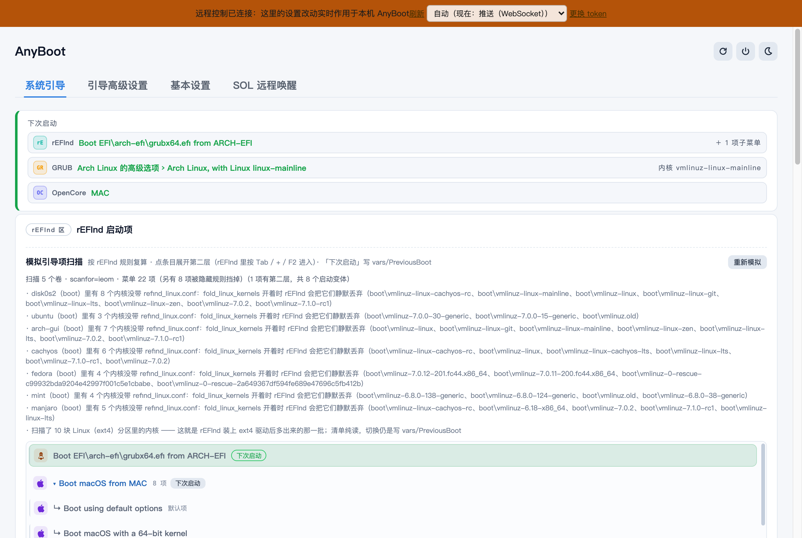
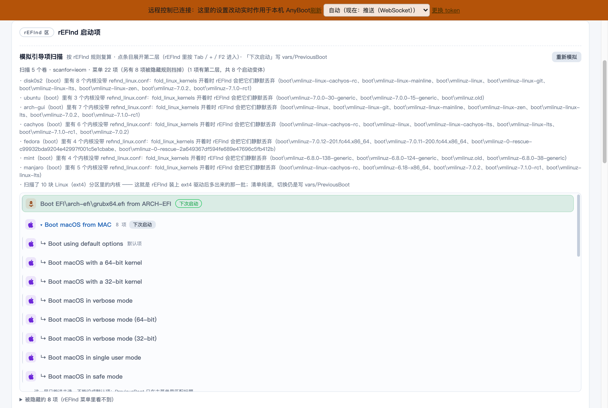
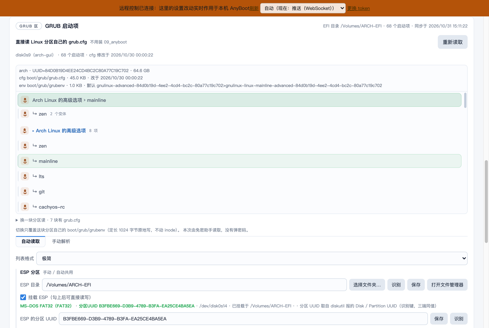
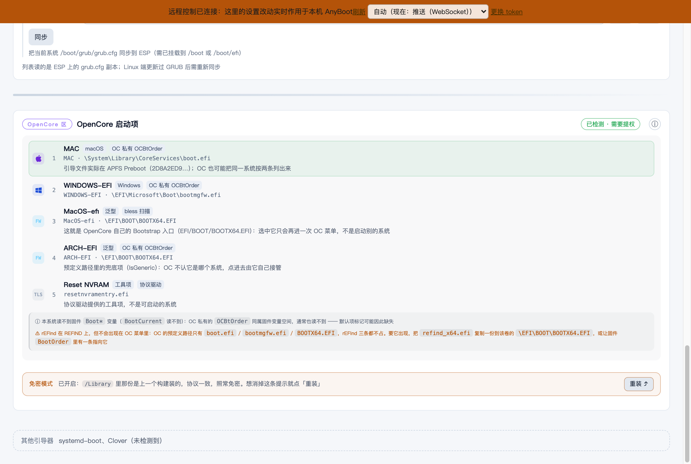
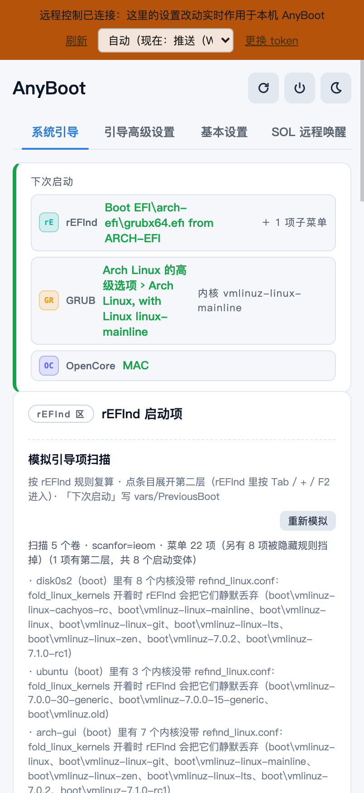

<div align="center">

# AnyBoot

**在任何一个系统里，决定下次开机进哪个系统 —— 还能在手机上远程做这件事。**

一个基于 Tauri 2 的跨平台引导管理 + 远程电源工具：
托盘点一下切换下次启动项，rEFInd / GRUB / OpenCore / systemd-boot / Clover 五大引导器统一管理，
内置 HTTP 服务让你用浏览器、手机 App、curl、ssh 远程切系统、重启、关机、睡眠。

[](https://github.com/lidiaoo/anyboot/releases)


Windows / macOS / Linux 三端同一份代码，行为对齐。

**[下载安装](#快速开始) · [功能总览](#功能总览) · [平台支持](#平台支持矩阵) · [文档归档](#文档归档)**

</div>

---

## 截图

**系统引导页 —— 三个引导器的下次启动一目了然，点一下就切换：**



**rEFInd 模拟引导项扫描 —— 按 rEFInd 官方规则（scan.c）纯读复算菜单，不重启就知道下次进 rEFInd 会看到什么，选中即写 `PreviousBoot`：**



**GRUB 自动读取 —— 直接读各 Linux 分区自己的 `/boot/grub/grub.cfg` 出启动项，点内核即写 grubenv 切换：**



**OpenCore 菜单预演 —— 不重启预演 OC 菜单（每项标来源），「设为默认」等价于进 OC 按 Ctrl+Enter：**



**手机浏览器 / App 打开同一个地址，就是同一份界面：**



---

## 功能总览

### 1. 引导切换（核心）

- **托盘菜单直接切换**：右键托盘 → 点 `Linux` / `Windows` / `macOS`，菜单第一行就写明「下次启动：X」，选中项带 ◉。
- **五大引导器统一管理**：rEFInd、GRUB、OpenCore、systemd-boot、Clover 各一张卡片（状态 chip、健康检查、当前默认 / 上次启动、一键切换）。
- **rEFInd 模拟引导项扫描**：读 rEFInd 0.14.2 源码按官方规则纯读复算菜单 —— scanfor、dont_scan_*、also_scan_dirs、图标线索、HiddenTags、PreviousBoot 全对齐；还原两层结构（子屏）与折叠规则；**选中即写 `EFI/refind/vars/PreviousBoot`，不重启就定下次默认项**。
- **GRUB 直读与切换**：不装任何东西，直接读 Linux 分区自己的 `/boot/grub/grub.cfg` 出启动项（ext4 直读，LVM/LUKS 上层的 ext4 经块设备路径也能扫到）；点内核直接写目标分区 grubenv（`saved_entry`/`next_entry` 双写、1024 字节定点覆盖、原子替换 + SHA-256 校验）。
- **OpenCore 菜单预演 + 设为默认**：预演 OC 菜单（每项标来源：`BootOrder` / bless / Preboot / 协议驱动），「设为默认」写 OC 私有命名空间 `OCBt*`，macOS 上也能用（原理见 [`docs/opencore-菜单解析与预演.md`](docs/opencore-菜单解析与预演.md)）。

### 2. 远程控制（HTTP 服务）

- **内置 HTTP 服务**：默认开启 `0.0.0.0:12300`、token 必填；webhook / curl / 面板 / 手机 App 都能远程切系统与电源动作。API 全表见 [`docs/远程控制-HTTP-API.md`](docs/远程控制-HTTP-API.md)。
- **状态推送**：`GET /api/ws`（WebSocket）改动即推，空闲几乎不发包；轮询兜底可切换。
- **远程请求通知弹窗 + 延迟执行**：远程请求先弹置顶小窗倒计时（默认 5 秒），可取消；HTTP / ssh 两条渠道分开配（延迟秒数 0–30）。
- **CLI 一条命令**：与 GUI 同一个可执行文件，`ssh user@host 'anyboot --switch windows --action reboot'` 就够（参数表见 [API 文档](docs/远程控制-HTTP-API.md#ssh-远程调用两种用法)）。
- **常见面板接入**：UpSnap、Home Assistant、Node-RED、Postman、路由器计划任务……能发 HTTP 就能接。

### 3. 客户端（Web / 移动端）

- **Web 端 = 主窗口**：浏览器打开 `http://<电脑IP>:12300` 就是同一份界面（同一份 `ui/` 代码、同一份状态快照），操作真实生效。
- **Android / iOS App**：WebView 外壳，一台电脑一个标签，多网卡地址自动切换、多机分组管理。
- **远程操作先经本机同意**：网页 / 手机上的切换会变成一条「远程请求」，电脑端弹授权窗倒计时确认（详见 [`docs/客户端-web-移动端.md`](docs/客户端-web-移动端.md)）。

### 4. 电源动作

- 重启 / 关机 / 睡眠，主窗口、托盘、HTTP、CLI 四个入口走同一套命令表。
- **macOS 不需要管理员密码**：走 AppleEvent → System Events（苹果菜单同一条链路），首次授权一次永久免框。
- **Windows 睡眠预检**：休眠启用时如实告知「本次会变休眠」，不糊弄。
- 三级退让（Linux）：`systemctl` → `loginctl` → `pkexec`。

### 5. 免密提权体系（三端一致）

| 平台 | 方案 |
|---|---|
| macOS | 免密助手（root 后台进程，协议 v2），一次安装永久免密 |
| Windows | 特权助手服务（MSI 自动注册），远程 / 无人值守提权 |
| Linux | root 助手 + sudoers 白名单 + 参数闸门，「关于」页一键安装 / 卸载 |

安全设计：助手参数白名单、结果文件路径闸门、visudo 绝对路径清空环境、写入原子替换 + SHA-256 校验。详见 [`docs/权限与提权.md`](docs/权限与提权.md)。

### 6. 桌面体验

- **不占任务栏 / Dock**，托盘常驻；托盘菜单三端都是应用自绘小窗（点选择项不关菜单）。
- **主题**：暗色 / 亮色 / 跟随系统；窗口不透明度 0–100%。
- **窗口自适应**：分辨率 / 缩放变化自动重置；位置居中可保持；记忆拖拽后的尺寸。
- **开机启动 + 启动隐藏**：macOS 走 `SMAppService`，Windows 写注册表，Linux 写 autostart。
- **单实例**：重复启动自动接管旧实例（认 pid + 核对进程名，先礼后兵）。

### 7. 性能

- 分区表合并查询 + 60s 缓存：**全盘扫描 8.3s → 1.0s**，热刷新 25ms。
- 分段埋点（`trace.log` 每步耗时表）。

---

## 平台支持矩阵

### 引导器能力

| 能力 | macOS | Windows | Linux |
|---|---|---|---|
| rEFInd 模拟扫描 + 切换（写 PreviousBoot） | ✅ | ✅ | ✅ |
| GRUB 直读 ext4 分区 grub.cfg 出启动项 | ✅ | ✅ | ✅ |
| GRUB 切换（写 grubenv） | ✅ 免密助手 | ✅ 特权服务 | ✅ 免密 sudoers |
| GRUB grub.cfg → ESP 同步（09_anyboot 方案） | ✅ | ✅ | ✅（硬性条件见[文档](docs/grub-自动同步条件.md)） |
| OpenCore 菜单预演 + 设为默认 | ✅ 写 `OCBt*` | ✅ | ✅ efivarfs 直读 |
| systemd-boot / Clover 状态与切换 | ✅ | ✅ | ✅ |

### 系统能力

| 能力 | macOS | Windows | Linux |
|---|---|---|---|
| ESP 自动发现 | `/Volumes` + `diskutil` | 按 GPT 类型列出（带「分配盘符」按钮） | 挂载点 + `lsblk` 未挂载 ESP 临时只读挂载 |
| 免密提权 | 助手协议 v2 | 特权服务（MSI 注册） | sudoers 白名单助手 |
| 电源动作免密 | AppleEvent（本就免密） | 特权服务 / UAC 兜底 | systemctl 三级退让 |
| 固件变量 | 仅 OC 私有 `OCBt*`（Apple 拦 `Boot*`） | `Boot*` 读写 | `Boot*` + `OCBt*` |
| 开机自启 | `SMAppService` / LaunchAgent | 注册表 Run | `~/.config/autostart` |
| NVIDIA 白屏自处理 | — | — | ✅ 按会话类型自动设开关 |
| 主题 / 透明度 / 自绘托盘 | ✅ | ✅ | ✅（SNI 协议自导出图标） |

### 已知限制（如实说明）

- btrfs / LUKS **加密卷内**的文件级读取不支持（LVM/LUKS 上层的 ext4 经块设备路径可扫到）。
- GRUB 直读切换要求目标分区 journal 干净；脏分区（RECOVER 标志）会拒绝并提示。
- OC 预演的 macOS / Preboot 条目目前仅 macOS 上算得出来（Windows/Linux 无 APFS 驱动；正在用纯 Rust APFS crate 补齐，见[选型文档](docs/apfs-预演三端统一选型.md)）。
- Linux GNOME 默认无传统托盘，需启用 StatusNotifierItem 扩展（主窗口不受影响）。

---

## 快速开始

### 安装

从 [Releases](https://github.com/lidiaoo/anyboot/releases) 下载对应平台安装包：

| 平台 | 文件 |
|---|---|
| macOS（Intel + Apple Silicon 通用） | `AnyBoot_<版本>_universal.dmg` |
| Windows | `AnyBoot_<版本>_x64-setup.exe` 或 `.msi` |
| Linux | `.deb` / `.rpm` / 全兼容 `.AppImage` |
| Android（debug 签名） | `AnyBoot_<版本>_debug.apk` |
| iOS（未签名，自行 Xcode 签） | `AnyBoot-unsigned.ipa` |

装好首次启动：托盘图标出现 → 主窗口自动扫出各引导器与系统列表 → 点一下就是「下次启动」。

### 三分钟上手远程控制

```bash
# 1. 拿 token：主窗口 → 远程控制 → 复制（或读配置文件）
#    macOS:   ~/Library/Application Support/com.example.anyboot/settings.json
#    Windows: %APPDATA%\com.example.anyboot\settings.json
#    Linux:   ~/.config/com.example.anyboot/settings.json

# 2. 浏览器打开（手机也行）
open http://<电脑IP>:12300

# 3. 或一条命令：切到 Windows 并重启
curl -s -X POST -H "X-Auth-Token: <token>" \
  "http://<电脑IP>:12300/api/switch-and-power?system=windows&action=reboot"

# 4. 或 ssh
ssh user@<电脑IP> 'anyboot --switch windows --action reboot'
```

完整端点表、安全默认值、防火墙放行、多机管理见 [`docs/远程控制-HTTP-API.md`](docs/远程控制-HTTP-API.md)。

### 从源码运行

```bash
npm install
npm run tauri dev        # 开发
npm run tauri build      # 打包
npm run build:mac-universal   # macOS 通用二进制（其他平台命令见构建文档）
```

---

## 文档归档

### 使用文档

| 文档 | 内容 |
|---|---|
| [`docs/远程控制-HTTP-API.md`](docs/远程控制-HTTP-API.md) | HTTP 服务全部细节：安全默认值、token、防火墙、端点表（含可复制 curl）、电源命令表、通知弹窗、常见面板接入、多机管理、ssh 两种用法、本机授权 |
| [`docs/客户端-web-移动端.md`](docs/客户端-web-移动端.md) | Web 端 / Android / iOS 客户端：同一份界面的三种形态、远程确认机制、推送 vs 轮询 |
| [`docs/应用设置.md`](docs/应用设置.md) | 出厂默认值、开机启动、主题与透明度、提示音、窗口行为 |
| [`docs/权限与提权.md`](docs/权限与提权.md) | 三端免密提权方案、Linux 免密组件安装与卸载、安全加固清单 |
| [`docs/FAQ.md`](docs/FAQ.md) | 远程连不上、单实例、端口占用、睡眠变休眠、NVIDIA 白屏、Linux 设置保存失败…… |
| [`docs/grub-自动同步条件.md`](docs/grub-自动同步条件.md) | GRUB grub.cfg → ESP 自动同步的硬性条件 |

### 原理与设计文档

| 文档 | 内容 |
|---|---|
| [`docs/opencore-菜单解析与预演.md`](docs/opencore-菜单解析与预演.md) | OC 菜单的三个真实来源、为什么能预演、三端 NVRAM/ESP 差异 |
| [`docs/boot-menu-discovery.md`](docs/boot-menu-discovery.md) | 引导菜单发现的原理与用法 |
| [`docs/boot-menu-discovery-internals.md`](docs/boot-menu-discovery-internals.md) | 逐函数源码追踪与实机验证过程 |
| [`docs/grub-自动读取-选型与落地.md`](docs/grub-自动读取-选型与落地.md) | GRUB 直读 / 切换的选型、实现与踩坑（§16-19 为最新迭代） |
| [`docs/apfs-预演三端统一选型.md`](docs/apfs-预演三端统一选型.md) | Windows/Linux 补齐 Preboot 条目的技术选型 |
| [`docs/linux-privilege.md`](docs/linux-privilege.md) | Linux 免密提权设计与安全边界 |
| [`docs/windows-免UAC提权-服务方案.md`](docs/windows-免UAC提权-服务方案.md) | Windows 特权助手服务方案 |
| [`docs/server-hub.md`](docs/server-hub.md) | 桌面端远端管理窗口（ssh / sftp / 隧道 / 跳板机） |
| [`docs/backup-design.md`](docs/backup-design.md) · [`docs/backup-ui-design.md`](docs/backup-ui-design.md) | 备份功能设计 |
| [`docs/remote-api-plan.md`](docs/remote-api-plan.md) · [`docs/remote-api-todo.md`](docs/remote-api-todo.md) · [`docs/remote-pairs.md`](docs/remote-pairs.md) | 远程 API 的规划、待办与配对实现 |

### 子模块文档

| 目录 | 文档 |
|---|---|
| `ui/` | Web 界面：[`ui/README.md`](ui/README.md) |
| `mobile/` | 移动端总览：[`mobile/README.md`](mobile/README.md)（Android / iOS 各有 README） |
| `linux/` | Linux 附加组件（grub 自动镜像服务） |
| `scripts/` | 构建脚本（jammy AppImage 等） |

---

## 安全模型（一图流）

```
本机操作          ──► 应用内直连命令 ──────────────── 即时生效，不弹窗
远程 HTTP / ssh   ──► token 校验 ─► 授权弹窗倒计时 ──► 可取消，到点执行
远程切换引导       ──► 只写引导器自己的状态文件/变量 ──► 不碰系统引导配置
写入动作          ──► 临时文件 + 原子替换 + SHA-256 ──► 写失败不留半截状态
```

- HTTP 是明文（无 HTTPS）：只在可信局域网或 SSH 隧道用；token 必填、日志只记指纹。
- 详细安全约定见 [`docs/FAQ.md`](docs/FAQ.md#注意安全与边界)。

---

## License

[Apache License 2.0](LICENSE)。
