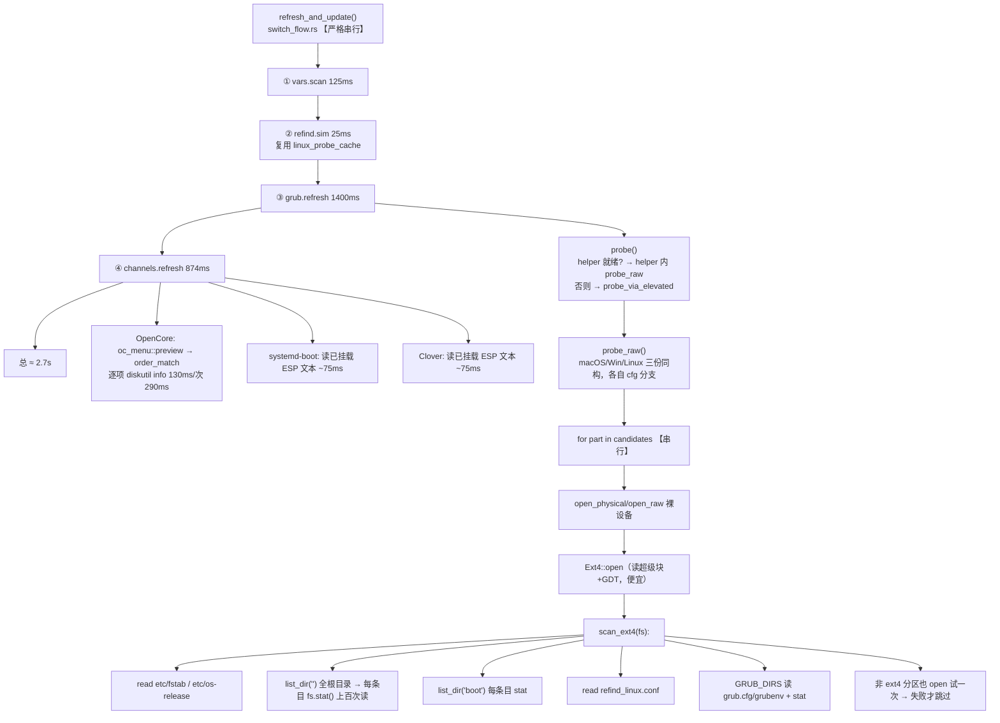
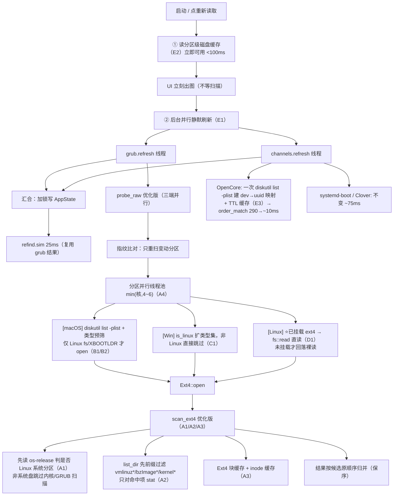
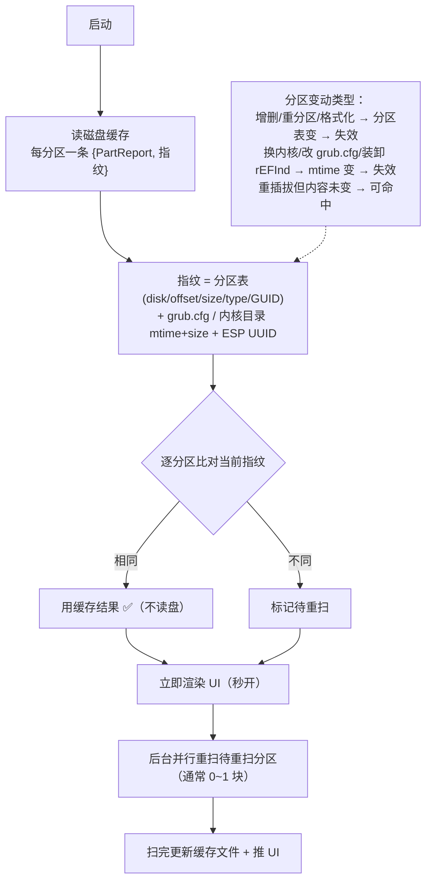

# 引导器扫描性能优化方案（GRUB / OpenCore，三端统一）

> 2026-11-07。目标：把「启动 / 重新读取」的扫描从实测 ~2.7s 压到首次 <1s、缓存命中亚秒。
> 依据：真机 macOS `trace.log` 的 `[perf]` 段实测（10 块 Linux 分区、SSD）+ 各平台读取逻辑代码审计。
> 相关代码：`src-tauri/src/switch_flow.rs`、`channels/linux_grub.rs`、`channels/ext4_raw.rs`、`channels/oc_menu.rs`、`channels/mod.rs`、`channels/partitions.rs`。

## 0. 实测基线（macOS 真机，现在）

一次 `refresh_and_update()` 严格串行：

| 段 | 耗时 | 占比 | 位置 |
|---|---|---|---|
| `vars.scan` | ~125ms | 4% | NVRAM 变量 |
| `refind.sim` | ~25ms | 0% | 复用 `linux_probe_cache`，不扫盘 |
| **`grub.refresh`** | **~1400ms** | 56% | `linux_grub::refresh → probe → probe_raw`（三端同构，串行裸读 ext4） |
| **`channels.refresh`** | **~874ms** | 32% | 三通道 |
| ├ `channels.opencore` | ~724ms | 27% | `oc_menu::preview` |
| │ ├ `oc.preview` | ~505ms | 19% | |
| │ │ └ **`oc.order_match`** | **~290ms** | 11% | 逐项 `diskutil info`（~130ms/次，跨 refresh 无缓存） |
| ├ `esp.probe` | ~145ms | 5% | ESP 探测 |
| └ `vars.scan` | ~125ms | 4% | |
| **合计** | **~2.7s** | | |

**结论**：三端中只有 **GRUB 是全盘 ext4 裸读**；OpenCore **不扫全盘**，慢在 **diskutil 逐条调用**；systemd-boot / Clover 只读已挂载 ESP 文本（~75ms）；rEFInd 模拟复用 GRUB 结果（~25ms）。启动时四个步骤 **串行累加**。

---

## 1. 当前架构逻辑图

**三端枚举差异**：

| 平台 | 枚举 | 缓存 | 读取 | 备注 |
|---|---|---|---|---|
| macOS | `diskutil info -all` | ❌ 无 | `open_physical` 全分区试 | 枚举慢，APFS/HFS/FAT 也 open 试 |
| Windows | `partitions::all()` | ✅ 60s | `open_partition`，`is_linux()` 预筛但非 Linux 仍 open 试 | 只认 `0FC63DAF` |
| Linux | `lsblk` | — | `open_raw(/dev/sdXn)` **裸读** | 有内核 ext4 驱动却不用的浪费 |

---

## 2. 优化后架构逻辑图

---

## 3. 分区级磁盘缓存失效逻辑（E2）

**要点**：分区变动一定让相关缓存失效（这是正确性底线）；但用**分区级缓存**，只重扫变的**那一块**，其余命中，所以局部变动几乎不影响启动速度。

---

## 4. 优化内容明细

### A. 公共层（改一处，三端生效）

| # | 优化 | 现状问题 | 改法 | 预期 |
|---|---|---|---|---|
| A1 | **scan_ext4 短路：先判 Linux 系统分区** | 每块 ext4 都全量读 fstab/os-release/全根目录/内核/GRUB_DIRS，数据盘白扫 | 先读 `etc/os-release`（或 fstab 含 `/`）；非系统盘跳过根目录/内核/GRUB 扫描，只留 label/uuid | 数据盘多时省 60-80% |
| A2 | **内核清单先前缀过滤再 stat** | `list_dir("")` 后对每条目 stat（每条 1-2 次 4K 读），根目录上百条 | 按 `vmlinuz*/bzImage*/kernel*` 前缀过滤，只对命中项 stat（取 mtime） | 每分区省 90%+ inode 读 |
| A3 | **Ext4 块缓存 + inode 缓存** | `read_block`/`inode()` 每次 pread 无缓存 | LRU 块缓存（512×4K≈2MB）+ `HashMap<u32,Inode>`（group_desc 已有缓存） | 首次再降 10-20%，重复访问近 0 |
| A4 | **分区级并行** | 三端 `for part` 串行 | `std::thread` 线程池，并发 min(核,4~6)；结果按原顺序归并；denied/notes 归并 | 分区多时近 N× |

### B. macOS 专属

| # | 优化 | 改法 | 预期 |
|---|---|---|---|
| B1 | 枚举换快的 | `diskutil info -all` → `diskutil list -plist`（含分区 Content 类型）+ 枚举结果缓存 | 枚举降一半 |
| B2 | 类型预筛 | 只对 `Linux fs(0FC63DAF)` / `XBOOTLDR(bc13c2ff)` 等 Linux 相关类型 `open_physical`，跳过 APFS/HFS/FAT | 少开大量设备 |
| B3 | helper 同受益 | root helper 跑同一 `probe_raw`，改动自动进 helper | 同 |

### C. Windows 专属

| # | 优化 | 改法 | 预期 |
|---|---|---|---|
| C1 | 非 Linux 直接跳过 | `is_linux()` 扩类型集（补 XBOOTLDR 等）+ 非 Linux 不 `open_partition` 试 | 少开设备 |
| C2 | 分区表缓存策略 | 已有 60s 缓存 ✓ → 改「设备变更事件失效」而非短 TTL 重复跑 PowerShell | 稳定少跑 |
| C3 | 并发上限 4 | USB/UASP 外置盘并行掉速 → 线程池上限 4 | 防掉速 |

### D. Linux 专属（最大红利）

| # | 优化 | 改法 | 预期 |
|---|---|---|---|
| D1 | ⭐ 已挂载分区走挂载点直读 | `lsblk` 已给 mountpoint；已挂载 ext4 → `std::fs::read`（内核页缓存）；未挂载才回落 `open_raw` 裸读 | **10× 以上** |

### E. 跨引导器 / 启动层

| # | 优化 | 改法 | 预期 |
|---|---|---|---|
| E1 | 启动时 grub ‖ channels 并行 | 两线程并行，共享 `esp_candidates`，汇合加锁写状态；refind.sim 依赖 grub 放其后（25ms） | 启动 2.7s → max 段 |
| E2 | 分区级指纹磁盘缓存 | 每分区存 {结果+指纹} 落盘；启动先读缓存渲染 → 后台并行校验；只重扫指纹变的分区 | 重开亚秒 |
| E3 | OC diskutil 合并 + 缓存 | 一次 `diskutil list -plist` 建 dev→uuid 映射 + TTL 缓存（写 OCBtOrder/bless 后失效） | order_match 290→~10ms |
| E4 | 前端「重新读取」重试 6 次 | 改 1 次扫描 + 失败即报错 | 避免 ×6 放大 |

---

## 5. 三端优化后时间表（推算）

> 依据：macOS 真机实测基线 + 各项预期降幅。**变化量**：分区数、SSD/HDD、USB 外置盘、CPU 核数。实施后以真机 `trace.log` perf 段实测替换。

### ① 第一次启动 App（冷缓存、全量扫描）

| 平台 | 现在 | 优化后 |
|---|---|---|
| macOS | ~2.7s | **~0.4-0.6s** |
| Windows | ~2.5-3.5s（估） | **~0.5-0.7s** |
| Linux | ~1.4s（估） | **~0.1-0.2s** |

### ② 缓存命中

| 场景 | macOS | Windows | Linux |
|---|---|---|---|
| 重开 App（先渲染后后台校验） | ~0.1-0.2s | ~0.1-0.2s | <0.1s |
| App 未重启、再次进入 | <50ms | <50ms | <30ms |
| 有分区/文件变动（只重扫那块） | ~40-120ms | ~40-120ms | ~20-50ms |

### ③ 单个引导器「重新读取」

| 引导器 | macOS 现在→优化后 | Windows 优化后 | Linux 优化后 |
|---|---|---|---|
| GRUB | 1400 → **~300-350ms** | ~350-450ms | **~60-100ms** |
| OpenCore | 724 → **~180-230ms** | ~180-230ms | ~120-180ms |
| systemd-boot | 75 → ~60ms | ~60ms | ~30ms |
| Clover | 75 → ~60ms | ~60ms | ~30ms |
| rEFInd 模拟 | 25 → ~20ms | ~20ms | ~15ms |

### 汇总

| | macOS | Windows | Linux |
|---|---|---|---|
| 首次启动（全量） | 0.4-0.6s | 0.5-0.7s | 0.1-0.2s |
| 缓存命中（重开） | 0.1-0.2s | 0.1-0.2s | <0.1s |
| GRUB 单点重扫 | ~300ms | ~400ms | ~80ms |
| OC 单点重扫 | ~200ms | ~200ms | ~150ms |

---

## 6. 实施任务清单（按顺序，每步可验证）

- [ ] **T1（A1+A2+A3）** 公共层 `scan_ext4` 短路 + 按需 stat + Ext4 块/inode 缓存 —— 三端同时受益
  - 验收：`cargo build` 通过；真机 perf `grub.refresh` 下降；扫描结果与原来一致（分区/条目数、内核清单、默认项不变）
- [ ] **T2（D1）** Linux 已挂载 ext4 走 `fs::read` 直读，未挂载回落裸读
  - 验收：Linux 端 `grub.refresh` 大幅下降；结果一致
- [ ] **T3（A4）** 三端 `for part` 并行（线程池，结果保序归并；Windows 并发上限 4）
  - 验收：分区多时耗时下降；结果与串行一致（顺序/条目/notes）
- [ ] **T4（B1/B2、C1/C2）** macOS `diskutil list -plist` + 类型预筛；Windows 扩类型集 + 非 Linux 跳过
  - 验收：macOS/Win 枚举与打开设备数下降；结果一致（含 XBOOTLDR）
- [ ] **T5（E1）** 启动时 grub.refresh ‖ channels.refresh 并行
  - 验收：启动 perf 总时长 ≈ max(两段)；状态无竞态（加锁写）
- [ ] **T6（E3）** OC `diskutil list -plist` 一次建映射 + TTL 缓存，写 OCBtOrder/bless 后失效
  - 验收：`oc.order_match` 290→~10ms；默认项识别正确
- [ ] **T7（E2）** 分区级指纹磁盘缓存（启动先渲染、后台校验、只重扫变动分区）
  - 验收：重开亚秒；改 grub.cfg/换内核/加分区后能正确重扫该块
- [ ] **T8（E4）** 前端「重新读取」改 1 次扫描 + 失败即报错
- [ ] **T9** 全量回归：三端（或至少 macOS 真机）`trace.log` perf 前后对照表填实测值；ui-compare 冒烟

---

## 7. 实施结果（真机实测，2026-11-07）

### 已完成（T1-T8）
- [x] T1 A1/A2/A3：scan_ext4 短路 + 按需 stat + Ext4 块/inode 缓存
- [x] T2：Linux 已挂载 ext4 走挂载点直读（std::fs，内核页缓存）
- [x] T3/A4：三端分区并行（macOS/Linux 并发 min(核,6)；Windows 上限 4）
- [x] T4：macOS 枚举换 `diskutil list -plist`（2.13s→86ms）+ Linux 预筛；Windows 扩 XBOOTLDR 类型 + 非 Linux 跳过
- [x] T5：启动 grub.refresh ‖ channels.refresh 并行（perf 跨线程 span 回传）
- [x] T6：OC order_match 用「挂载点→DiskUUID」一次映射（505→85ms）
- [x] T7：分区级指纹磁盘缓存（linux_probe_cache.json；refresh_force 跳过）
- [x] T8：「重新读取」单次扫描（原 6 次重试）
- [x] **额外重大修复**：macOS `find_mounted_by_partuuid` 原用 `lsblk`（macOS 无此命令）→ 每次启动走 diskutil mount 1.4s；改 `mount` + `diskutil list -plist` 匹配已挂载设备 → grub.locate 1402ms→~150ms

### 真机 perf 对照（trace.log）
| 项 | 优化前 | 优化后 |
|---|---|---|
| **启动总耗时** | ~2.7s | **~0.75-1.0s** |
| grub.refresh（ESP 侧） | 1482-1568ms | **~280-370ms** |
| ├ grub.locate | 1402ms | **~150ms** |
| channels.all | 874-1158ms | **~700ms** |
| ├ oc.order_match | 290-505ms | **85ms** |
| ├ oc.preview | 505-743ms | ~320ms |
| oc（旧 helper 时） | 724ms | ~560ms |

> 注：grub.refresh 的 ESP 侧枚举已实测优化；`linux_grub::probe_raw`（全盘 ext4 扫描，
> 「重新读取」路径）同样受益于 list -plist/并行/缓存，但需在 App 内重装免密助手
> 后新代码才进 helper（helper = 主程序副本）。
