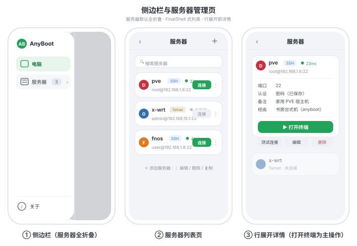
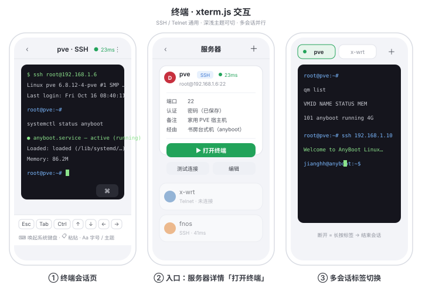
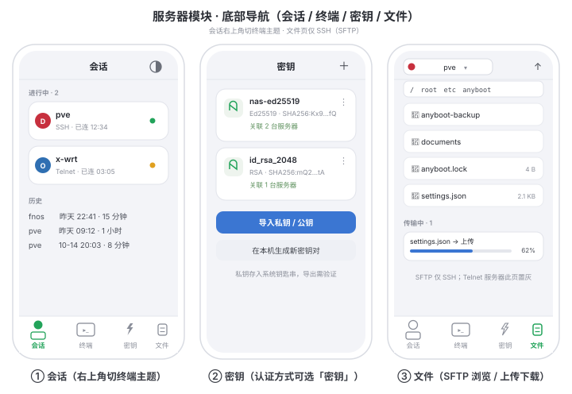
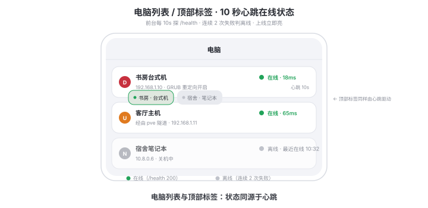
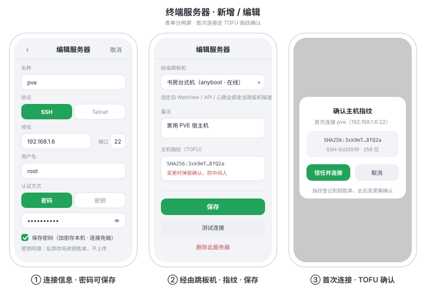
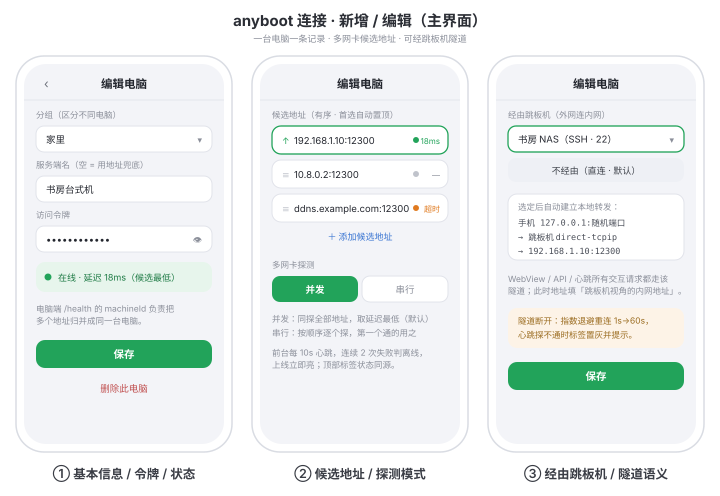

# AnyBoot 客户端（手机 App）TODO / 路线图

> 目标：在外网也能连上家里的 anyboot 电脑 —— 手机先 SSH/Telnet 登录公网可达的跳板机，
> 由跳板机在局域网内访问 anyboot 电脑端 HTTP 接口（SSH `direct-tcpip` 本地端口转发）；
> 同时把手机 App 升级为带交互终端、密钥管理、文件传输的完整运维客户端。
>
> 涉及平台：iOS（Swift/Citadel）、Android（Java/JSch）。桌面端（russh）为可选二期。

## 现状盘点（已有底子）

| 已有 | 说明 |
|---|---|
| `/health` 免鉴权探活 | 电脑端 http.rs 提供，返回 machineId + 机器名 |
| HealthProbe（两端） | 只在保存地址时**一次性**探，拿 machineId 归并多网卡多 IP |
| 多电脑标签 | 每台电脑一个顶部标签 + 一个 WebView；标签名「组名 · 服务端名」 |
| 多地址故障切换 | 串行：首选地址不通自动换下一个（换地址不换 WebView） |
| 地址归并 | addresses 有序 + machineId 归并，同一台电脑只占一个标签 |

## 功能清单

### F1 心跳模块（10 秒在线状态）—— 独立小改动，第一批做 ✅ 已实现（iOS `Heartbeat.swift` / Android `HeartbeatManager.java`）

- [x] 10 秒定时轮询全部电脑条目，探 `/health`（免 token），往返耗时作为延迟
- [x] 多地址候选：任一地址通 = 该电脑在线；多网卡探测模式按电脑可设（编辑表单分段选择）：
  - **并发（默认）**：同探所有地址，取 RTT 最低的作当前地址；断线直切已探活地址
  - **串行**：按顺序逐个探，第一个通的用之（现行为，保留地址优先级）
- [x] 上/下线时效：上线**立即亮**；连续 **2 次**失败才判离线（防 WiFi 抖动误报）；记 lastSeen（「最近在线 HH:mm」）
- [x] 状态源统一：顶部电脑标签的状态点改由心跳驱动（现在只在 WebView 加载事件变化）；绿=在线·延迟，灰=离线；加载黄点仅为切换标签瞬间的加载态
- [x] 仅前台轮询（iOS 进后台挂起 / Android onStop 停表），回前台立即先探一轮
- [x] 附加：停在错误面板上的那台，心跳一探通就自动重连（不用手点重试）
- [x] 带 jumpServerId 的条目：走隧道探（M2 隧道就绪后接上：`HeartbeatManager.tunnelResolver` / `Heartbeat.tunnelResolver`）

### F2 服务器模块（跳板机管理）—— M1 ✅ 已实现（Android `ServersActivity` / iOS `ServerModuleView`）

- [x] 数据模型 `JumpServer { id, 名称, 协议(ssh|telnet), 主机, 端口, 用户名, 认证(密码|密钥), 状态 }`（两端同构，JSON 键一致）
- [x] `ServerProfile` 加 `jumpServerId`（空 = 直连，行为与现在完全一致）
- [x] 侧边栏（主界面 ☰）：顶部 AB 标识；导航项「**电脑**」（回主列表）、「**服务器**」（默认**全折叠**，只有一行 + 数量徽标，点进独立页）；底部「**关于**」
- [x] 服务器独立页（参考 FinalShell）：发行版图标 + 名称 + 协议徽标 + 延迟 + 地址；行尾「打开终端」/ ⋮；点行展开详情（端口 / 认证 / 备注 / 经由此服务器的电脑 + 测试连接 / 编辑 / 删除）；顶部搜索框 + ＋
- [x] 添加/编辑服务器表单：协议分段选择（SSH·Telnet）、密码/私钥认证、测试连接
- [x] 添加/编辑电脑表单加「经由跳板机」选择器；地址栏语义变为「跳板机视角的内网地址」
- [x] 关于页：GitHub 仓库卡片（★/⑂ 实时拉 GitHub API，拉不到用缓存）+ Star 按钮（打开仓库网页，App 不代点）+ 更新日志 / 问题反馈 / 开源许可
- [x] M1 全程**纯本地不出网**（配置与 UI），先在真机审 UI

### F3 终端（xterm 交互）—— M2 ✅ 已实现（Android `TerminalActivity` / iOS `TerminalView`）

- [x] SSH：登录后开 **shell 通道**，字节流双向桥接到前端 **xterm.js**（WebView 渲染，支持 vim/htop/彩色/中文）
- [x] Telnet：TCP socket 字节流喂同一 xterm.js，过滤 IAC 控制字节（**实验性**）
- [x] 终端页：顶栏 = 服务器名 + 协议 + 断开；深色终端区；底部按键栏（Esc / Tab / Ctrl / 方向键，Ctrl 臂上字母行）+ 系统键盘唤起 + 粘贴 + 字号
- [x] **主题切换**：深色 / 亮色，偏好存本地（终端页右上角入口）
- [x] 多会话：顶部标签条同时开多台服务器，长按标签结束会话；后台保持（静态注册表）、回终端页接续
- [x] 跳板链路下终端落在跳板机 shell；操作内网机器在终端里再 ssh 过去（透明交互，不做自动级联）

### F4 SSH 隧道（外网连家里）—— M2 ✅ 已实现

- [x] 按需建连接 → `direct-tcpip` 通道 → 本地监听 `127.0.0.1:随机端口` → WebView 照常加载 localhost（token、/health、machineId 归并、transport 偏好全复用，网页端零改动）
- [x] **所有与该电脑的交互网络请求（WebView 页面、/api 电源操作、10 秒心跳 /health）都经由隧道发出**——即「经由跳板机」的电脑，其全部请求路径 = 手机 → SSH 加密通道 → 跳板机 → 内网 anyboot；本地只监听 127.0.0.1，不暴露端口
- [x] 同一跳板机的多条连接**复用一条 SSH 会话**；断线指数退避重连（1s→2s→…封顶 60s），回前台心跳立即重试

### F5 密钥管理 —— M1 ✅ 已实现

- [x] 密钥页（底部导航「密钥」）：密钥卡（名称 / 算法 / SHA256 指纹 / 关联数）+ 导入私钥 + 本机生成密钥对（Android：Ed25519 / RSA4096；iOS：Ed25519，OpenSSH 双格式导出）
- [x] 私钥存 **iOS Keychain / Android Keystore**（AES-GCM 加密落盘）；SSH 首连指纹确认（TOFU）并存住，对不上拒连
- [x] 服务器表单认证方式可选「密钥」并关联密钥库

### F6 文件传输（SFTP）—— M4 ✅ 已实现

- [x] 文件页（底部导航「文件」）：选服务器、面包屑路径、目录列表（大小）、上传下载
- [x] SFTP 仅 SSH（subsystem sftp）；Telnet 服务器此页置灰并提示

### F7 底部导航栏（服务器模块内部）✅ 已实现

- [x] 四页：**会话 / 终端 / 密钥 / 文件**；作用域仅服务器模块，侧边栏「电脑」主列表不变
- [x] 会话页：「进行中」（状态点 + 时长）+「历史」（时间 · 时长）

## 平台选型

| 端 | SSH 库 | 说明 |
|---|---|---|
| iOS (Swift) | Citadel（SwiftNIO SSH） | 密码/密钥认证 + 自建 channel 桥接 + sftp |
| Android (Java) | JSch | shell channel / `setPortForwardingL` / sftp |
| 桌面 (Rust，可选二期 M5) | russh | 与现有 tokio 栈同源 |

## 里程碑（每步可交付验证）

- [x] **M0 心跳**：F1 全部（iOS + Android；含标签状态统一、并发/串行探测）
- [x] **M1 配置与 UI**：F2 + F5 存储/密钥页 + F7 导航骨架（纯本地不出网）
- [x] **M2 隧道 + 终端**：F3 + F4（SSH 会话栈一套两用；密钥认证接入；心跳走隧道）
- [x] **M3 稳定性**：会话复用、断线重连（指数退避）、ServerAlive 保活、后台挂起恢复（心跳停表回前台补探；终端会话后台保持）
- [x] **M4 文件 + Telnet**：F6（SFTP）；F3 的 Telnet 实验通道
- [ ] **M5 可选**：桌面端 russh + 侧边栏（远程管理其他电脑）—— 未做（可选二期）

## 实现状态与验证口径（2026-10-16）

- **Android**：全部源码 javac 编译级检查通过（android-34 stub + jsch-0.2.20.jar）。
  完整 APK 需在有 SDK 的环境打包实机验证（老流程：Windows E:\Android 或重建 SDK）。
- **iOS**：静态走查级 —— 本机无 Xcode。SSH 相关代码按 Citadel main 分支（2026-10）
  API 签名校对，首次 Xcode 构建如遇小幅漂移按 `SshSessionManager.swift` 注释校准。
  工程需加 SwiftPM 依赖 Citadel。
- **待真机验证清单**：① 添加 SSH 服务器 → 测试连接（TOFU 弹窗 → 信任 → 在线）；
  ② ▶ 终端出 shell、按键栏、主题切换；③ 添加电脑选「经由跳板机」→ 页面/心跳走隧道；
  ④ 密钥生成 → 复制公钥上服务器 → 免密登录；⑤ 文件页浏览/上传/下载；⑥ 关于页 Star。

## UI 设计图（docs/client-ui/）

## UI 设计稿决策记录（会话内定稿）

- 侧边栏：电脑 / 服务器（默认折叠，一行 + 数量徽标 + ›）/ 关于；主列表叫「电脑」避免与跳板机「服务器」歧义
- 服务器页对齐 FinalShell：系统图标、名称、协议徽标、延迟、连接按钮、行展开详情（端口/认证/备注/经由 + 测试连接/编辑/删除 + ▶ 打开终端主操作）；「本地/云仓库/导入」一期不做
- 添加服务器表单：协议分段选择（SSH·Telnet）、密码/私钥认证、测试连接；添加电脑表单只加「经由跳板机」选择器，地址语义变为「跳板机视角的内网地址」
- 关于页：App 图标 + 版本 → GitHub 仓库卡片（★/⑂/Issues 实时拉 API，失败用缓存）→ 黑色 ★ Star 按钮（打开仓库网页，App 不代点）→ 更新日志 / 问题反馈 / 开源许可
- 终端：xterm.js + 底部按键栏（Esc/Tab/Ctrl/方向键）+ 深/亮主题切换 + 多会话标签；入口为服务器详情「▶ 打开终端」
- 服务器模块底部导航：会话 / 终端 / 密钥 / 文件，仅模块内部生效
- 心跳：电脑列表行与顶部标签共用状态源；绿=在线·延迟，灰=离线·最近在线时间；连续 2 次失败才判离线

## 待确认

- [ ] Star 引导指向的仓库地址（暂按 `lidiaoo/anyboot`）
- [ ] M1 / M2 是否合并一批出（先看终端效果）
