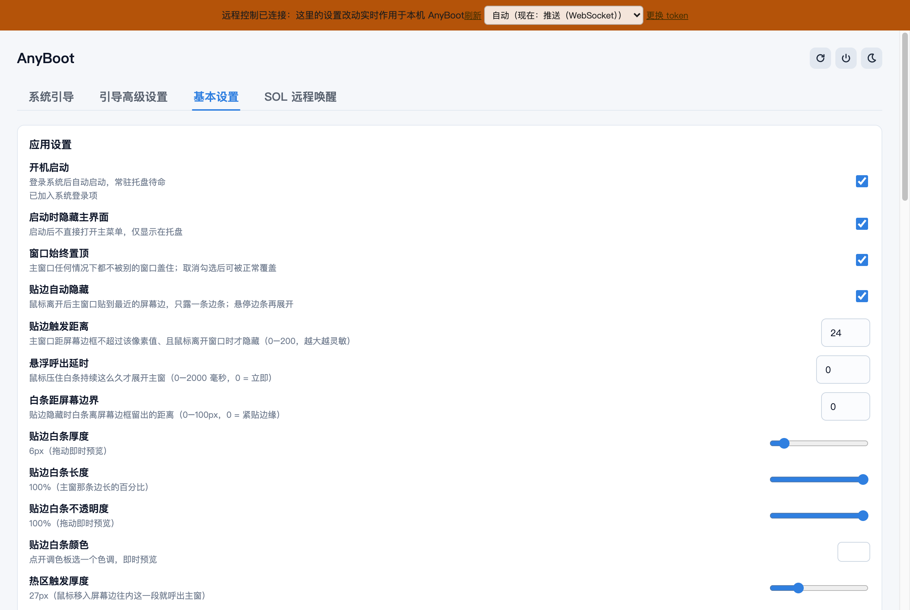
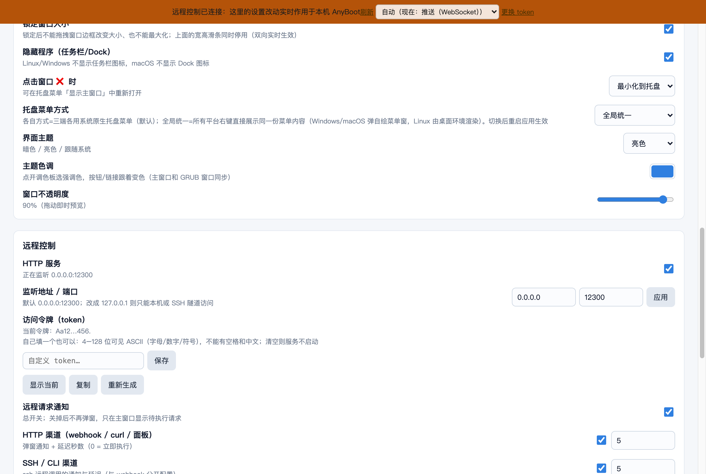

# 应用设置

> 原 README「应用设置」章节归档。

**出厂默认值**（全新安装，或删掉 `settings.json` 里对应字段后重启）：主题**亮色**、
窗口不透明度 **90%**、窗口位置固定在**屏幕（工作区）正中央**、
窗口高度默认占**屏幕工作区高度的一半**（宽度随 GRUB 展示方式）、
「远程可触发本机授权框」**开**。这些都能在主窗口里改，改完立刻落进 `settings.json`。

窗口尺寸一旦拖过就按**记忆值**来（不再每次启动重算）；想回到「屏幕一半」，
在设置里点**重置窗口大小**即可。

窗口位置选**「屏幕中间」**时，拖高度滑条会**保持居中** —— 窗口上下同时伸缩，不会只往下长、
更不会被挤到屏幕上沿去。选「上次位置」或「自由」时按原来的锚点伸缩，不做干预。

## 分辨率 / 缩放自适应

显示器分辨率 / 缩放变化时自动重置窗口大小（三端同策略，DPI 按显示器生效采样 + 轮询兜底）。

## 主窗口「应用设置」区域

- **开机启动**：登录系统后自动启动应用。
  - macOS 13 及以上调用系统登录项接口 `SMAppService.mainApp` 注册，条目出现在「系统设置 → 通用 → 登录项与扩展」。该接口要求应用带有效代码签名，因此 `tauri.conf.json` 默认配了 ad-hoc 签名（`bundle.macOS.signingIdentity = "-"`）；未签名、未以 `.app` 形式运行或 macOS 12 及以下会自动退回 `~/Library/LaunchAgents/AnyBoot.plist`，界面会提示当前用的是兼容方式。签名版本生效后，早期版本遗留的 LaunchAgent 会在启动时自动清理。
  - Windows 写 `HKCU\Software\Microsoft\Windows\CurrentVersion\Run`；Linux 写 `~/.config/autostart`（即使以 root 执行也会识别 `SUDO_USER`/`PKEXEC_UID`，写回实际登录用户）。
  - 若系统返回「需要批准」（`requiresApproval`），主窗口会给出提示与「打开登录项与扩展设置」按钮。
- **启动时隐藏主界面**：登录/启动后只在托盘待命。
- **点击窗口 ❌ 时**：`最小化到托盘` 或 `退出程序`。
- **界面主题**：`暗色` / `亮色` / `跟随系统`。选「跟随系统」时，系统在亮/暗之间切换会实时跟着变（不用重启应用）。
- **窗口不透明度**：0%–100%。拖动即时预览，松手保存。窗口开了透明（`tauri.conf.json` 的 `transparent`），所以调低能真的透出桌面；拉到 100% 就是完全不透明。0% 是**全透明**（窗口还在、托盘菜单照常能操作），只是看不见而已。
  - 若你的桌面没有合成器（例如裸 X11 + 没有 picom/compton；Cinnamon、GNOME、KDE 都自带），透明窗口可能显示为黑底 —— 把不透明度拉回 100% 即可，或把 `tauri.conf.json` 里的 `"transparent": true` 去掉。
- **提示音**：内置了一段 **KakaoTalk 风格的通知音**（编在二进制里：`src-tauri/assets/kakaotalk-notify.wav`；要商用请换成自己的音频）。收到远程请求、弹出通知窗时由**后端用系统播放器**播：Linux `paplay` → `aplay` → `ffplay`，macOS `afplay`，Windows PowerShell `Media.SoundPlayer`。想换成自己的音频：在「提示音」那行填文件路径（WAV 最稳 —— Windows 的 SoundPlayer 只认 WAV PCM），播放失败会自动回落内置音；关掉「提示音」开关就完全不响。播放结果会写进 `trace.log`（`[sound] 已播放…`）。
- **远程控制**（详见 [`远程控制-HTTP-API.md`](远程控制-HTTP-API.md)）：HTTP 服务开关、监听地址/端口、token（自己填 / 显示 / 复制 / 重新生成）、远程请求通知开关、两条渠道各自的通知与延迟、远程可触发本机授权框、待执行请求卡片、最近请求列表、「远程怎么调」的调用示例（**进界面就展开**，含 token 可直接复制）。

设置持久化在配置目录的 `settings.json`。**主窗口和托盘菜单双向联动**：任何一边改了都会立刻保存、把新内容推进托盘菜单窗，并广播同一份状态快照给主窗口与通知弹窗，两边不会出现“一边勾选、一边没变”。开机启动以系统真实状态为准，在系统设置里手动改过之后重新打开主窗口会自动同步。

## 「关于与更新」区域（2026-10-31）

设计稿见 [`检查更新-设计.md`](检查更新-设计.md) 与 [`update-ui-mockup.html`](update-ui-mockup.html)，实现在 `src-tauri/src/update.rs` + `ui/index.html` 的 `#update-section`。

- **当前版本**：读二进制的 `package_info().version`（`tauri.conf.json` 与 `Cargo.toml` 必须同时改，否则永远是「已是最新」）。
- **检查更新**（按钮 / 托盘「检查更新…」同一入口）：主通道是 `HEAD github.com/lidiaoo/anyboot/releases/latest` 读 302 → 取 tag（**零速率限制**）；匿名 API 只作为补充通道取更新日志，403 就静默降级为「只有版本号没有日志」。
- **有新版本**：卡片显示版本、发布日期、release 正文（**纯文本**渲染，不执行 HTML）、安装包名与体积；`下载` 开始下载，`跳过这个版本` 写入 `updateSkipVersion`（跳过只是不弹托盘提醒，设置页仍可随时装）。
- **下载**：直连 GitHub → `ghfast.top` → `gh-proxy.com` 逐源回退（`updateMirror` 可固定成某一个），进度条 120ms 刷新；下载完**必须**通过 `SHA256SUMS.txt` 的 SHA-256 校验才允许安装——校验文件缺失或哈希不符一律不装。
- **安装并重启**：会先过**安全闸**——任何进行中的引导切换 / 电源操作 / 扫描都不允许装（按钮置灰并说明原因）。macOS 是挂 dmg → `ditto` 到旁路临时名 → 原子替换原 `.app`（装在 `~/Applications` 也认，路径由 `current_exe` 反推）；Windows 是退出自身后以 `setup.exe /S` 静默安装（UAC 由安装器清单触发，安装钩子会重注册助手服务）；Linux AppImage 原子替换自身并留 `.old`，deb/rpm 走 `pkexec` 提权安装。
- **自动检查**：默认开，启动 30 秒后一次、之后每 12 小时一次；自动检查**失败静默**（只写 trace，不在界面报错）——只有手动检查才把错误展示出来。
- **下载源**：`自动（直连 → 镜像）` / `只直连 GitHub` / `镜像 ghfast.top` / `镜像 gh-proxy.com`。走系统代理的环境需要 ureq 的 `proxy-from-env` feature（`Cargo.toml` 已开，见设计文档 §7.3 的审计记录）。
- **远程页面不显示这块**：更新只在本机窗口里做（远程触发更新本机应用既没有进度事件通道，也不该开这个口子），网页/hub 电脑页 iframe 里会整块移除。
