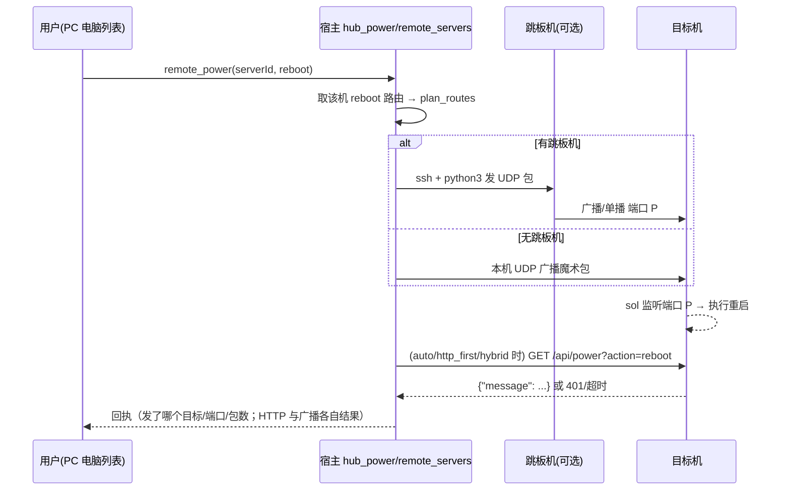

# 远程电源动作实现梳理（唤醒 / 睡眠 / 重启 / 关机）

> 2026-11-21。覆盖：**PC 远程管理 → 电脑列表**、**Web（浏览器版全同 UI）**、**Android**、**iOS**，
> 以及被控机自己的 `/api/power`。
> 相关代码：`src-tauri/src/hub_power.rs`、`remote_servers.rs`、`power.rs`、`remote_routing.rs`；
> `ui-vue/src/components/hub/ComputerRow.vue`、`stores/remote.ts`；
> `mobile/android/.../ComputerListActivity.kt`、`WakeOnLan.java`、`PowerOps`（HTTP）；
> `mobile/ios/AnyBootRemote/Power/PowerOps.swift`、`WakeOnLan.swift`。

## 1. 一句话总览

四个动作本质只有两条通道：

1. **标准 WOL 魔术包**（UDP）—— 唤醒必须用它；睡眠/重启/关机也复用（由目标机上的 `sol` 监听端口执行）；
2. **目标机自己的 AnyBoot 接口** `GET /api/power?action=…&token=…` —— 机器醒着才通。

每台电脑的「电源路由（`power_routes`）」决定**发什么、发到哪、用哪条通道、两条通道怎么组合**。
`本机` 这一行例外：不走网络，直接在进程内执行系统命令（`power.rs`）。

## 2. 数据模型

### PowerRoute（每台电脑可多条，按 action 过滤）

| 字段 | 含义 |
|---|---|
| `action` | `wake` / `reboot` / `shutdown` / `sleep`（空 = wake） |
| `target` | 广播地址（`192.168.0.255` / `255.255.255.255`）或单播 IP / 主机名；**空 = 自动** |
| `port` | UDP 端口（0 = 9）。不同端口 = 不同动作，由目标机的 `sol` 监听 |
| `macs[]` | 用哪些网卡 MAC（空 = 该电脑配过的全部 MAC） |
| `enabled` | 关掉但不删 |
| `burst` / `retry` | 这条发几个包 / 没全发出去再打几轮（默认 10 / 10，间隔 200ms） |
| `mode` | `packet_only` / `auto`(默认) / `http_first` / `http_only` / `hybrid` |
| `http_fallback` | 兼容旧字段 |
| 电脑级 `primary_jump_id` | 跳板机（该机只有跳板机可达时用） |

## 3. 统一算法（PC / Web / Android / iOS 同一口径）

### 3.1 编译计划（`hub_power::plan_routes`）

1. `macs` 为空 → 用该机全部 MAC；一个都没有 → 记 problem（标准魔术包必须有 MAC）；
2. `target` 为空 → 自动目标 = **每个访问地址所在 /24 的广播 + `255.255.255.255`**
   （子网广播更可能真的送到；**非唤醒动作只取第一个目标**，避免同包到两次被执行两次）；
3. 包体 = 标准魔术包 `6×0xFF + MAC×16`；唤醒为**每个 MAC 一个包**，其它动作用第一个 MAC；
4. `times = burst`、`retry = retry`（0.2s 一轮）。

### 3.2 发送（`hub_power::send_plan`）—— 直连 / 跳板机 / **混合（默认）**

每条路由带 `broadcast_link`：`direct`（只本机 UDP）/ `jump`（只经跳板机）/ **`both`（默认：有无跳板机都发）**。
`send_plan` 按链路拆两批：

- 直连侧：本机 `UdpSocket` + `SO_BROADCAST` 直发（配了跳板机也照发）；
- 跳板机侧：`ssh 跳板机` 上跑内嵌 python3（计划表 base64 传入），每次重试**重连跳板机再发**；
  没配跳板机 → 该侧记错误，直连成功仍算成功并如实汇报「其余通道失败」；
  跳板机没 python3 → 该侧直接报错（不自愈）；Telnet 跳板机不支持；
- 一个包都没发出去 = 失败（提示：隔离网络 / 防火墙拦 UDP / 广播地址写错）；
- 全过程 `trace.log` 里 `[power]` 行**无条件**记录（不受 debugTrace 开关影响）。

### 3.3 模式（`hub::routes_mode` 合并 + 执行分支）

### 3.3 HTTP 通道设置（新增）

- 每条路由带 `http_link`：`direct` / `jump` / **`both`（默认）** —— 决定 HTTP 走直连侧、跳板机侧还是同时；
- 电脑级 `power_http_kinds`：**多选**（lan / jump / tunnel / ts / funnel / tsnet，默认全选），
  勾选的通道**同时发** `/api/power`，全部结果逐条汇报（任一成功即成功）；
- **跳板机侧的 HTTP**：先 `remote_endpoint` 建 SSH 本地转发，再打 `127.0.0.1:<port>/api/power`
  （2026-11-21 补齐，之前跳板机只服务广播包）。

| 模式 | 行为 |
|---|---|
| `packet_only` | 只发广播包，失败就失败 |
| `auto`（默认） | 先广播包；失败 → 调目标机 `/api/power` 兜底 |
| `http_first` | 先 HTTP；失败 → 发广播包 |
| `http_only` | 只 HTTP |
| `hybrid` | HTTP 与广播包**并发**，四种结果分支都如实汇报 |

> 多条路由取「最强」模式：任一 hybrid → hybrid；任一 http_first → http_first；全 http_only → http_only；否则 auto。
> **未配路由时**：唤醒 → 默认广播（每 MAC 10 包 / 重试 10）；其它动作 → 直接调目标机 `/api/power`。

## 4. HTTP 通道

`remote_http_power`：
- 按 `route_candidates()`（局域网地址优先，隧道/ts 兜底）逐个尝试；**jump 候选在电源路径被跳过**（拿不到转发端点）；
- `GET /api/power?action=…&token=…`；15s 读超时（关机途中响应慢）；
- `401` → 「这台电脑不认这个 token」；`4xx/5xx` → 带原始 body；
- `wake` 特例：能收到请求就说明机器本来就醒着 → 服务端回 `WakeAck`，不做动作。

## 5. 本机行（`serverId="local"`）

- `wake` → 「本机正在运行，无需唤醒」；
- 其它 → `power::spawn_power`（进程内，与托盘/主窗同一套）：
  1. **忙闸** `try_begin_power`：已有电源动作在跑 → 忽略本次点击并写行动记录（「上一个电源动作还没结束」）；
  2. 按平台尝试链执行（见 §6），失败可提权（Linux → `pkexec` 图形授权；macOS 候选自带 admin；Windows 无）；
  3. 成功后 `schedule_power_release`：**15 秒**后若仍在线就放闸，并记录「已提交但系统仍在」；
  4. 远程触发（`/api/power`）默认 **`REMOTE_NO_GUI_AUTH`**：不允许弹本机授权框，只能用免密 sudo / AppleEvent（`remoteAllowGuiAuth` 可放开）。

## 6. 本机命令矩阵（`power.rs::power_attempts`）

| 动作 | Linux | macOS（按顺序尝试） | Windows |
|---|---|---|---|
| 重启 | `systemctl reboot` → `loginctl reboot` | AppleEvent `System Events restart` → `sudo -n /sbin/shutdown -r now` → `osascript … with administrator privileges` | `shutdown /r /t 0` |
| 关机 | `systemctl poweroff` → `loginctl poweroff` | AppleEvent `shut down` → `sudo -n /sbin/shutdown -h now` → admin 授权 | `shutdown /s /t 0` |
| 睡眠 | `systemctl suspend` → `loginctl suspend` | AppleEvent `sleep` → `sudo -n /usr/bin/pmset sleepnow` → admin 授权 | `rundll32 powrprof.dll,SetSuspendState 0,1,0`（开了休眠会变休眠，预检会说明） |

## 7. 各端实现对照

| 端 | 点击点 | 到后端 | 实际执行 |
|---|---|---|---|
| **PC（Tauri 远程管理）** | 电脑列表每行 4 个电源键（本机行的「唤醒」置灰并提示「本机无需唤醒」） | `stores/remote.ts power()` → `invoke("remote_power", {serverId, action})` → `remote_servers::remote_power_blocking` | 本机 → `power::spawn_power`；远端 → §3 计划 + §3.2 发送 / §4 HTTP |
| **Web（浏览器打开 hub）** | 同一套 ui-vue 组件 | `POST /api/ui-command` `{cmd:"remote_power", args:{serverId, action}}`（token 保护） | 同 PC 的 `remote_power_blocking`（跑在宿主上） |
| **Android** | 每行 4 个 `PowerButton` | `powerMessage(profile, action)`（同一套 5 模式） | `WakeOnLan.sendRoutes / wake`（本机 UDP / **经 JSch 跳板机广播** / 路由目标）+ `PowerOps.send(/api/power)`；`powerTarget` 用上次选通的地址+令牌 |
| **iOS** | 每行 4 个按钮 | `PowerOps.perform(profile, action)`（同一套 5 模式，15s 超时） | `WakeOnLan.sendRoutes / wake`（直发 / **经 NIOSSH 跳板机**）+ `PowerOps.send(/api/power)` |

## 8. 典型时序（PC 点「重启」）

## 9. 关键约束与常见“没反应”原因

1. **非唤醒动作需要目标机安装 `sol` 并监听该端口**——没有 sol，包收到了也不会执行（回执里已写明）。
2. 跳板机需 `python3`；Telnet 跳板机不能发 UDP。
3. UDP 广播可能被防火墙/隔离网络拦；`target` 写错也发不出去（`[power]` 日志能看到发到哪）。
4. **MAC 必填**（魔术包 0xFF×6 + MAC×16）。
5. 非唤醒动作只发第一个自动目标（同包到两次会被执行两次）。
6. Windows 的「睡眠」在启用休眠的机器上会变成休眠（只读预检会提示）。
7. 提交成功 15 秒后仍在线 → 自动放闸并记录「已提交但系统仍在」（防止按钮永久灰）。
8. 远程请求默认**禁止弹本机授权框**（安全）；需要时开 `remoteAllowGuiAuth` 或配免密。
9. 排障入口：`trace.log` 里 `[power]` 行（按没按、发没发、发给谁、几包、从哪发）。

## 10. 已知差异 / 待补

- **跳板机只用于 UDP 广播通道**：HTTP 通道（`/api/power`）在 PC/Android/iOS 都不经跳板机转发（PC 明确跳过 jump 候选；移动端只把跳板机用于广播）。若某台机器**只有跳板机可达**且目标机没装 `sol`，则睡眠/重启/关机无法执行 —— 需要在跳板机上做端口转发（未实现）。
- 移动端没有「本机」行（不给自己发电源动作）。
- 魔术包是明文 UDP，无重放保护（协议本身如此）。
